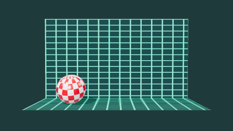
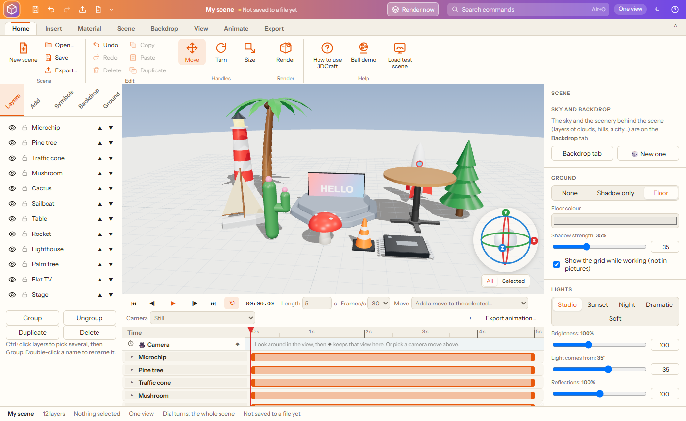
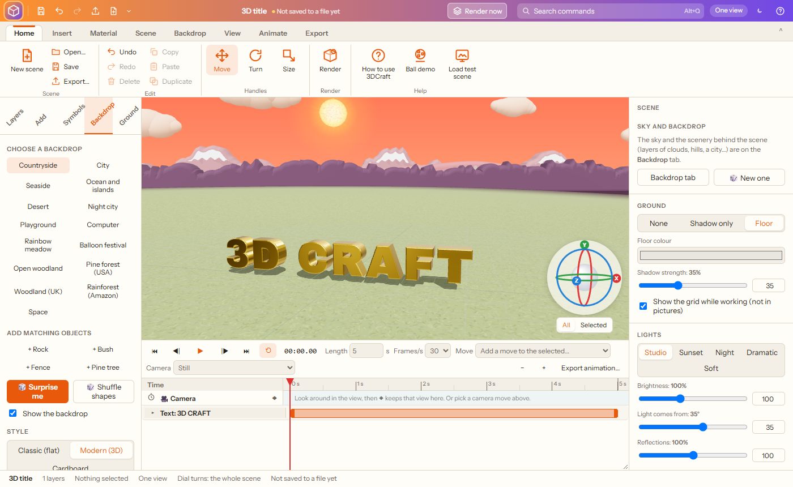
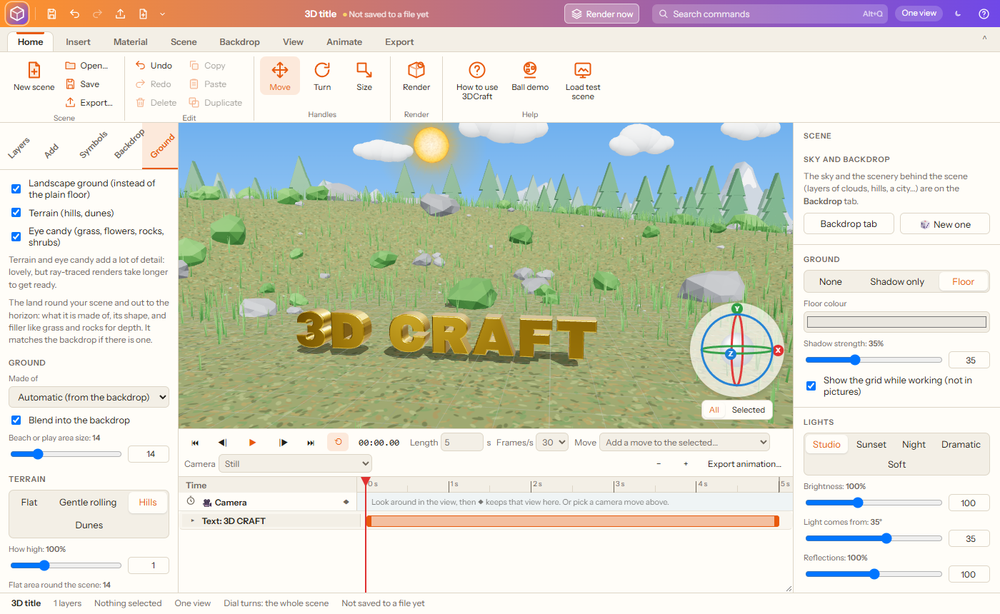
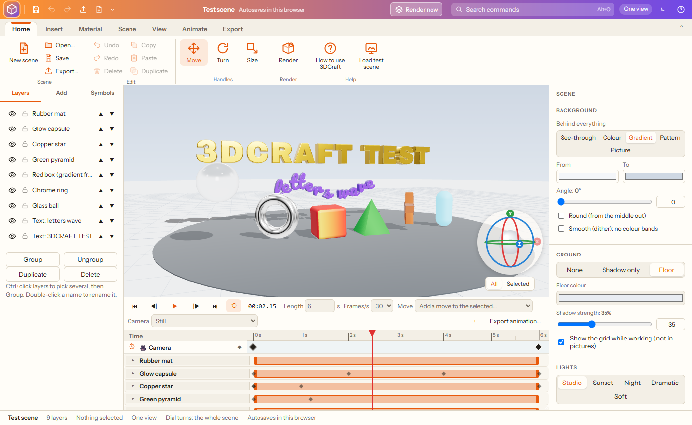

# 3DCraft

**3D titles, logos and scenes in your browser: shapes, 3D text, pictures turned into 3D, objects and scenery, layered backdrops and landscapes, materials, lights, animation with a timeline, ray-traced renders, and 3D models in and out.**

3DCraft brings back the easy 3D title and logo programs of the 1990s, rebuilt for today. Type a word and it stands up in 3D gold; drop a logo in and it is traced into colours and pulled out into a solid; pick plastic, chrome or glass; turn it all with the dial in the corner; then render a photo-real picture or save a model for a 3D printer. Everything works offline from this folder.

*The bouncing ball demo, made and exported as a GIF in 3DCraft: a nod to one of the first famous computer animation demos of the 1980s.*

## Getting started

1. Download this repository (green **Code** button › **Download ZIP**) or clone it.
2. Double-click `index.html`. It opens in Chrome or Edge.
3. Pick a starter scene (3D title, retro chrome, shapes still life, glass and gold, the **test scene**, the **bouncing ball demo** (a retro checkered ball bouncing and spinning in front of a grid) or the **doll demo** (a rag doll with fur hair and a polka-dot dress who blinks, turns her head, waves, and holds a spinning rainbow pinwheel, with a flag flapping in the wind)) or an empty one. **Load test scene** (Home › Help) is a ready-made scene for trying everything: letters spinning in and waving, glass, chrome, gold, copper, glow, plastic, matte and rubber, a gradient on a face, the checkered ball bouncing behind the title, a TV with colour bars scrolling down its screen, ready-made moves, and the camera going all the way round; everything ends where it began, so it loops seamlessly. It starts playing straight away.
4. Add things, change them, then **Render** or **Export**.

Your scene autosaves in the browser; **Save** keeps a `.3dcraft.json` file (pictures and models are kept inside it).

## What it does

### Building

- **Shapes:** box, rounded box, sphere, cylinder, cone, pyramid, prism (3 to 24 sides), doughnut, flat ring, capsule, star (any number of points), heart and flat panel, each with its own sizes.
- **Stage** to stand things on: round, oval, square, rectangle, hexagon or octagon; width, depth and height; corners from sharp to round; a rounded rim; 1 to 6 **steps** (a podium) and how far each comes in. Give its top, sides and bottom their own colour, gradient, pattern or picture, and stretch it to distort it.
- **Objects** (Insert › Objects, or the Add tab), each made of parts that can have their own colour, picture or pattern: **palm tree** (height, lean, leaves, coconuts); **tables** with a round, square or rectangle top on one centre leg with feet out to four sides, or on four legs; a **computer monitor** (ultra-thin, on a stand); **flat TVs** (43 and 65 inch, any size); a **CRT TV**; and an original little **test boat**. Put a picture on a monitor's or TV's **screen** and it lights up like a real screen.

- **Scenery objects** to go with the backdrops (Add tab › Scenery, or **Add matching objects** on the Backdrop tab): rock, asteroid, crater, rocket, flying saucer, sailboat, lighthouse, beach umbrella, microchip, capacitor, street lamp, bench, traffic cone, pine tree, tree stump, mushroom, cactus, bush, fence and a **flag** whose cloth flaps in the wind (strength and speed), each with its own parts and colours (rocks, asteroids, cacti and bushes take a shape number for a different one).
- **3D text** in 42 fonts (bold and blocky, clean, classic, script, techno and retro), with depth, rounded edges (bevel), letter spacing (letters keep a little apart, and only touch when you turn it below zero), **height** (from short and fat to tall and thin), several lines and alignment.
- **Picture to 3D:** drop a logo or drawing on the view (or Insert › Picture to 3D). It is traced into clean outlines in a few colours (**Best match** finds how many, or choose 2 to 16), with detail and smoothing, and the background left out; each colour is pulled out into 3D, flat or **stepped** (each colour at a different height), in the picture's own colours or a material of your choice.
- **Clean up the picture first** (Picture to 3D and Photos to 3D): pick the best of four background removals side by side (Whole picture, Gentle, Normal, Strong; only background touching the outside goes, so white details inside stay), fine-tune the tolerance, then touch it up on the preview with Photoshop-style tools: **Magic wand** (click an area to take it out), **Eraser** and **Restore** brushes, **✂ Trim** (click points round what to keep: everything outside goes) and **Lasso cut** (click points round something to take out), **Invert** (what was taken out comes back and the rest goes: mark what to keep, then invert), and **Show the mask** to see what will go in red over your picture while you try things, with Undo and Start again. On the preview, the **middle mouse button moves the picture** and the **wheel zooms** in on the spot under the mouse, for close work on edges (double middle-click goes back to fit).
- **Describe it** (Insert › Describe it): type what you want in plain words, e.g. *a red mug, two blue glass vases and a gold trophy* or *the word "HI" in chrome*, and it is made from 3DCraft's own shapes, objects and round things (cup, mug with a handle, vase, bottle, wine glass, bowl, jar, trophy, chess pawn, candle, flower pot, bucket). It reads how many, size (small, big, tall, wide), colour (any colour name, light or dark), material (gold, chrome, glass, plastic, glossy, matte, copper, velvet…), hollow or solid, and words in quotes become 3D text. **You see what it understood before anything is made**, and it says plainly what it does not know yet. With AI helpers on, words it has no name for are matched by meaning (a teapot → the mug, a spaceship → the flying saucer, a lantern → the street lamp), only when the match is clear.
  - **Look for pictures** (also offered when Describe it is only guessing the closest thing): for a word it does not know (a dragon), **🔎 Look for pictures of “dragon”** searches open picture libraries (Openverse and Wikimedia Commons; only when you click, and the word is sent to them). The results are ranked so the clearest references come first (AI checks each is clearly the thing; plain backgrounds and solid shapes beat busy photos and line drawings), each with its licence and creator. **Use this one** hands it to Photos to 3D: clip art and silhouettes are puffed up into a rounded shape, photos have their sides filled in. The picture is a reference for the **shape**: the model is one colour unless you tick “Paint it with the picture”, and the reference's title, creator, licence and page are kept in the object's notes.
- **Photos to 3D** (Insert tab, Add tab, Insert menu), made into a coloured mesh you can light, animate, render or save as STL/OBJ for printing:
  - **One photo (a guess):** something on a plain background is cut out and raised into a 3D shape: choose the **edge shape** (Round, Angled, Square or Puffy), how far the edge **reaches in** (just the outside, for a flat top like a badge or cookie, up to the whole shape, fully domed), the **thickness**, some of the photo's shading as bumps, and a flat back for a printer's bed.
  - **Puffy (clip art):** for clip art, icons, emoji and dingbats, like a puffy sticker. The picture's few flat colours are found, the outline is rounded like a cushion, and every smaller colour area (eyes, cheeks, stripes, outlines) gets its own rounded bump on top (**Details stand out** sets how much). The back is a plain rounded mirror, or flat for printing; each area keeps its clean colour. Clip art found by Look for pictures uses it.
  - **Round (spun, like a cup):** for cups, mugs, vases, bottles, glasses, trophies and chess pieces seen from the side. The outline's half width on each row is spun all the way round into a real round body, solid or **hollow** (open at the top, with a wall thickness); the picture wraps round the front and the back takes each band's own colour; a handle or spout sticking out on one side is kept as a rounded piece.
  - **Four views (fills in the rest):** one picture is the front; the **back, left and right are filled in** from it (AI depth for how thick each part is; the back the same picture mirrored, or softened so a face is not repeated) and shown as a sheet before anything is built. **Use my picture…** on any side replaces a filled-in view with a real one: the more you give, the closer it gets. Then the four are carved and painted together. What is it? sets what to expect (a cup comes out round, carved from 16 angles), and every result is **checked**: how well it matches each side, and whether it is round when it should be. If not, it says what is wrong and what to try.
  - **Expect** (Four views): Automatic (What is it? decides), Round, **Boxy** or Figure. Boxy gives the front picture a depth you set with straight, flat sides (the sides in the colours along the front's edges); give a picture of its side as well for the true shape (one front picture cannot show what is on top, so studs on a brick come out as ridges). The check warns when a boxy thing comes out rounded.
  - **What is it?** With AI helpers on, the picture is recognised first (CLIP, in the browser) and the kind of shape that suits it is suggested, with what to expect: a cup → Round; a figure, animal or sculpture → AI depth; a logo or sign → Picture to 3D. One click uses it.
  - **Turntable photos:** 12 to 36 photos of an object turned evenly on a turntable (camera kept still, plain background) are carved into its shape from every angle and painted with the photos. Deep hollows can't be seen from outside. **Hollows from AI depth (experimental)** works out the depth in every photo too and carves away what enough photos agree is further back (dents, gaps); it is off to start with while it is tried on real photo sets.
- **AI helpers** (Insert › AI helpers): small AI models that run **inside your browser**, with no server, account or key, and nothing sent anywhere. 3DCraft checks the computer when it starts (graphics card, its abilities, processor threads, memory) and ticks the boxes to suit; change anything you like. Each model downloads once when first used (or with **Download now**), then works offline; **Remove downloaded models** frees the space.
  - **AI cut-out:** a fifth start next to Whole picture / Gentle / Normal / Strong in Picture to 3D and Photos to 3D. It finds the main subject of a photo and takes away even a busy background (U²-Net, about 4 seconds a picture). Tick **Best-quality cut-out** for finer edges such as fur (BEN2, slower, graphics card only).
  - **🎯 Keep object (AI)** and **Take out object (AI)**: touch-up tools next to the magic wand. Click an object and it is outlined for you (SlimSAM): keep just it, or take it out. Click more of it to add to it; Shift-click a part that is not it.
  - **Recognise objects** (CLIP ViT-B/32, MIT): says what a picture shows, so Photos to 3D can suggest the right kind of shape before any work starts.
  - **AI depth** for one photo: Photos to 3D › Shape from › **AI depth** (or **Both**, half puffed up and half depth). It works out how near each part of the photo is (Depth Anything V2), so the shape follows the real object instead of a balloon guess.
  - With a graphics card the browser can use (WebGPU), depth and picking run on it in about a second or less; without one they run on the processor, slower but the same.
- **Photo cut-out:** any picture or photo cut out round its shape (by its see-through parts, or a plain background removed with a tolerance) and made into a solid with the photo on the front and back, a thickness, rounded edges and an emboss (Relief). Animate it, render it, or save it as GLB, OBJ or STL.
- **3D symbols and emoji:** the Symbols tab puts dingbats (Noto Sans Symbols 2) and emoji (Noto Emoji) into the scene as solid 3D shapes.
- **3D models and scans in:** GLB, GLTF, OBJ, STL and **PLY**, kept inside the scene file. Scans from photogrammetry apps come in with their colours: a PLY mesh or point cloud with a colour on every point, or an OBJ chosen (or dropped) together with its **MTL and texture pictures**. Then size, light, animate and render them, or save them again as STL or OBJ for printing.

### Materials

Plastic, glossy paint, matte, gold, silver, chrome, copper, glass, glow, **water** (clear and blue with ripples that drift when the animation plays; try it on a stage for a pool) and rubber, then colour, shine, metal, glass (see-through), glow and opacity. Put a **picture, gradient, pattern or colour on every face, or only on the front, back, sides, top or bottom** (shapes and 3D text have their own faces). Gradients and the 33 patterns are the same as in the other Craft apps. **Fabrics:** cotton, denim, velvet, silk and felt, with a weave pressed into the surface (plain, twill, knit or satin), weave size, sheen (the soft glow of cloth) and softness. **Fur or hair** on anything: length, thickness, a lighter tip colour and droop. **Relief (emboss)** raises the light parts of any picture, pattern or gradient on a face (or the dark parts) so it catches the light like embossed card or carved stone, from flat to 300%, in the view and in ray-traced renders. **Colour cycling** makes bands of colour scroll through an object while the animation plays, like the moving colours of old computer logos: retro 8-bit bands, smooth rainbow, sunset glow (a smooth orange, pink and purple flow), shaded rainbow bars (each bar lit like a rounded chrome strip), fire, ocean, neon, gold shimmer or copper bars, with speed, number of bands and direction (up, down, up and down, left, right, side to side); on a monitor or TV it plays on the screen only (on 3D text, the front only if you like).

### Moving and turning

- Click something, then drag its **arrows** (move, W), **rings** (turn, E) or **boxes** (size, R), or type exact numbers on the right.
- **Hold the middle mouse button on an object to drag it** (it slides in the plane facing you). Over empty space the middle button slides the view.
- **The dial in the corner** stays put: drag a coloured ring to turn around X, Y or Z, drag the ball to turn freely, click a letter to look along that axis, double-click the ball to reset. It turns **All** (the whole scene) or only the **Selected** object.
- **Layers:** hide, lock, rename, reorder and group; the view: one big view or **four views** (top, front, right, 3D).

### Backdrop

Scenery in layers behind your scene, like the flats of a stage or the layers of an old video game (the **Backdrop** tab on the left, and on the ribbon):
- **Choose a backdrop:** Countryside, City, Seaside, Ocean and islands, Desert, Night city, Playground, Computer, Rainbow meadow, Balloon festival, Space, Open woodland, Pine forest (USA), Woodland (UK) or Rainforest (Amazon) (click again for another one), or **🎲 Surprise me**; **🎲 Shuffle shapes** keeps the layers and gives them new shapes.
- Layers: **sun or moon, stars, clouds, mountains, hills, treeline, city skyline** (lit windows at sunset and night), **sea, islands** (with palms), **playground** (swings, slide, climbing frame, seesaw, fence), **circuit board** (chips and glowing traces), **forest** (open woodland with big trees, pines, oaks, rainforest with umbrella-crowned giants, palms and vines, or ferns; with a density slider), and in the sky **floating pixels, birds, hot-air balloons, a rainbow and planets**.
- **Your own picture** as a layer: cut out by its see-through parts or a plain background, with a drop shadow, an embossed edge and an optional white die-cut border; it can repeat along the layer and scroll, and stands on a fold-out stand in Cardboard. Add, hide, reorder and delete them; each has its own height, haze, colour and shape.
- Three styles, for the whole backdrop or one layer: **Classic** (flat cut-outs with an embossed edge and a drop shadow), **Modern** (soft rounded 3D) and **Cardboard** (cut-outs with cardboard edges, propped up by fold-out stands, clouds on sticks; the stands can be hidden).
- **Detail level** (Simple, Normal, High, Extra), all made from the seed: finer mountain ridges, snow caps and shaded slopes, rooftops (water towers, spires, boxes) and shaded sides on the city, bushes and rocks on the hills, fuller clouds. **Planets** are textured worlds (banded gas giants, cratered rock, icy, and blue worlds with land and clouds), real spheres in Modern and Cardboard, with banded rings.
- **Palettes:** Day, Sunset, Night, Desert, Storm, Digital and Rainforest mist, which also set the sky; farther layers come out hazier.
- **Sun and moon** in detail (a glowing mottled sun with a corona and rays; a cratered moon with seas and a phase), and a **Sky traffic** layer: airliners with contrails, spaceships, airships and shooting stars crossing the far sky, timed to loop with the animation.
- **Matching ground** that takes the place of the plain floor and fades into the front layer of scenery, so they meet without a line: grass, grass with flowers, forest floor, sand, a beach with reflective rippling water beyond, paving, grass with a play surface, a neon grid or rocky ground. Automatic picks it from the backdrop; the beach or play area size can be set.
- Everything stands on the ground (nothing hangs below the horizon). All layers stand 75 to 100 units out and stay behind your scene from wherever the camera looks; raise or lower it all to meet the horizon.
- **Movement:** scroll speed (endless loop or pass by once) with nearer layers faster for depth, bobbing, and per layer **fly in, rise up or slide in**, and out again, at chosen times.

### Ground

The floor and the land round your scene and out to the horizon, all in one place (the **Ground** tab: **None**, **Shadow only**, **Plain floor** or **Landscape**, with floor colour, shadow strength and the grid, separate from the Backdrop and the Scene, with quick switches on the Backdrop ribbon tab: **Landscape ground**, **Terrain** and **Eye candy**; terrain and eye candy start off, so scenes stay light and quick to render): turn the landscape ground on or off (the backdrop stays as it is); what it is made of (automatic from the backdrop, or grass, flowers, forest floor, sand, beach and water, paving, play surface, neon grid, rock); **terrain** (flat, gentle rolling, hills or dunes, with height and how big a flat area stays round the scene); **filler** for depth: grass fuzz, flowers, rocks, pebbles and shrubs, thinning out towards the scene, with a new layout at a click or **Match the backdrop**; and **distance haze** so far things fade into the sky. Choosing a backdrop sets up land that suits it.

### Scene

Ground (none, shadow only, or a floor in any colour), lights (studio, sunset, night, dramatic, soft) with brightness and direction, reflections, and the camera lens.

### Render and export

- **Render now** (title bar, next to Search) starts a ray-traced picture of the scene straight away, at the size and quality last chosen.
- **Render (ray-traced)** (F9): light bounces like real light, for true reflections, soft shadows and glass that bends light. Pick a size (from a quick 640 × 360 look to 4K and print sizes) and a quality (**Draft, Good, High, Best**: 24 to 1000 samples). The picture clears up as you watch; stop any time and keep it. **Smooth the grain** (Off, Light, Medium or Strong; Medium to start) cleans up graininess while keeping edges and pictures sharp; change it after rendering to compare, without rendering again. **Edges (anti-aliasing):** normal, or 2×, 3× or 4× smoother (renders that much bigger and shrinks it; slower). See-through background too. Save PNG or JPG.
- **Export:** a quick picture of the view (PNG or JPG, up to 4K or print sizes, see-through if you like), or the 3D model as **GLB** (with colours), **OBJ** or **STL** (for 3D printing), all or only the selected object.

## Keyboard shortcuts

| Keys | What they do |
| --- | --- |
| Ctrl+N / O / S | New / open / save |
| Ctrl+E / F9 | Export / Render |
| Ctrl+Z / Ctrl+Y | Undo / redo |
| Ctrl+C / V / D | Copy / paste / duplicate |
| Delete | Delete |
| W / E / R | Move / turn / size |
| F | See everything |
| 1 / 3 / 7 / 5 | Front / right / top / ¾ view |
| Space / Home / End | Play or pause / start / end |
| , / . | One frame back / on |
| Ctrl+G | Group |
| Esc | Deselect |
| Alt+Q / F10 | Search commands / all menus |

### Animation

The **Timeline** under the 3D view works like a motion-graphics timeline:
- Each layer has a **timer bar**: drag its ends to set when it appears and disappears, or drag the middle to slide it.
- Twirl a layer open (▸) for **Position, Turn, Size, Colour and Opacity**. Click a **stopwatch** to animate one: from then on, moving, turning or sizing the object (with the handles, the dial, middle-mouse dragging or the numbers) makes a **keyframe** ◆ at the current time. ◆ adds or removes a keyframe at the current time.
- **Drag keyframes** to retime them; **double-click** one for how it moves on: linear, ease, ease in, ease out, hold or bounce. Delete removes the selected keyframe.
- **Letter by letter** for 3D text: the letters come in, go out, or keep moving one after another: typewriter, fade, drop in (with a bounce), rise up, grow, spin, flip, slide, scatter (fly together), wave, jump, rock and colour sweep. Choose how long each letter takes, how soon the next one starts, the order (first to last, last to first, middle out, ends in, random) and how far they move. A **Letters** row on the timeline shows when, and can be dragged.
- **Ready-made moves** for the selected object: spin, flip, bounce, fly in, rise up, fade in, fade out, grow in, pulse, float, wobble and colour cycle. The **camera** can stay still, go round on a **turntable** or **swing** to and fro, by any number of degrees and **from** any angle (where the turn begins, so a loop can start from the view you choose).
- **Size slider** under the corner dial, shown while an object is selected: smaller to larger on all axes at once (a quarter to four times, 100% in the middle), keeping any stretch; double-click it for 100%.
- **Camera keyframes:** look around in the view, then click ◆ on the **Camera** row to keep that view at the playhead; the camera swings smoothly from one kept view to the next (with the same eases). Ready-made camera moves: **push in, pull back, crane up, fly round and in**. You can still look around freely while working; the keyed camera takes over when you play or scrub, and clicking a camera keyframe shows that view.
- **Play** (Space), back to the start (Home), to the end (End), one frame back or on (, and .), **loop**, and drag the playhead to scrub. Set the length (up to 2 minutes) and 12 to 60 frames a second.
- **Export the animation** as an animated **GIF** (loops, see-through if you like), **MP4** (H.264), **WebM** (VP9), **AVI** (motion JPEG, the classic way) or a .zip of numbered **PNG frames**, from 480 × 270 up to 4K, square or upright for phones. Frames are drawn one at a time at exact times, so the result is smooth on any computer. Choose **Look: Ray-traced** (Draft, Good or High) and every frame is path-traced and smoothed, with real reflections, glass and soft shadows; the first frame takes longest while the ray tracer gets ready (up to half a minute), then each frame takes about a second at Draft on a typical graphics card, with a time-left estimate and Cancel.

## Requirements

A current Chrome, Edge or Firefox with WebGL 2. Ray-traced renders are much faster with a graphics card. The AI helpers need an internet connection the first time each model is used (they download from huggingface.co and are kept by the browser); they run fastest in Chrome or Edge with a graphics card (WebGPU).

## How this was made

This app is **vibe coded**: its author designed and directed it in plain conversation, feature by feature, and an AI coding assistant (Claude, by Anthropic) wrote the code.

It is a **genuine clean-room build**, not a decompiled or AI-rebuilt copy of anything:
- Nothing was decompiled, disassembled or reverse-engineered, in whole or in part.
- No code, artwork, fonts, icons or data files from any original program were used, and none were given to the AI to work from.
- 3DCraft is inspired by the 3D title and logo programs of the 1990s (such as Asymetrix Web 3D and 3D F/X), and its timeline by motion-graphics tools; only publicly known features and general ideas guided the design. Every line of code and every starter scene here was made new.

Open-source libraries it uses are listed with their licences in Credits.

## Credits

- [three.js](https://threejs.org) 0.186 (MIT) for 3D, with its add-ons for controls, loaders (GLTF, OBJ, MTL, STL, PLY) and exporters.
- [three-gpu-pathtracer](https://github.com/gkjohnson/three-gpu-pathtracer) and [three-mesh-bvh](https://github.com/gkjohnson/three-mesh-bvh) (MIT) for ray-traced renders.
- [opentype.js](https://opentype.js.org) (MIT) for 3D text from fonts.
- [gifenc](https://github.com/mattdesl/gifenc), [webm-muxer](https://github.com/Vanilagy/webm-muxer) and [mp4-muxer](https://github.com/Vanilagy/mp4-muxer) (MIT) for animated GIF, WebM and MP4.
- [ImageTracer](https://github.com/jankovicsandras/imagetracerjs) (public domain) for tracing pictures.
- Fonts from Google Fonts under the SIL Open Font License or the Apache License, stored in `fonts/` (run `python fetch_fonts.py` to download them again).
- Emoji and symbol names from Unicode data (Unicode License).
- [Transformers.js](https://github.com/huggingface/transformers.js) 3.8 and [ONNX Runtime Web](https://onnxruntime.ai) (Apache-2.0 / MIT) to run the AI helpers in the browser (`lib/craft-ai-libs.js`).
- AI models, downloaded when first used: [Depth Anything V2 Small](https://huggingface.co/onnx-community/depth-anything-v2-small) (Apache-2.0), [SlimSAM](https://huggingface.co/Xenova/slimsam-77-uniform) (Apache-2.0), [U²-Net and U²-Netp](https://huggingface.co/BritishWerewolf/U-2-Net) (Apache-2.0) and [BEN2](https://huggingface.co/onnx-community/BEN2-ONNX) (MIT) and [CLIP ViT-B/32](https://huggingface.co/Xenova/clip-vit-base-patch32) (MIT).

## Development notes

How 3DCraft is built is described in [NOTES.md](NOTES.md).
