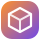
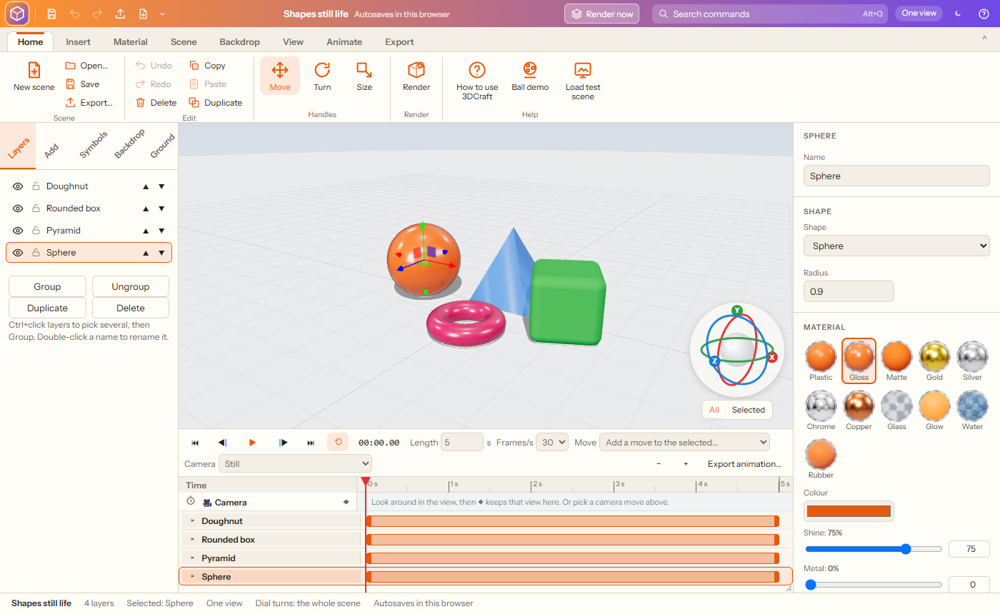
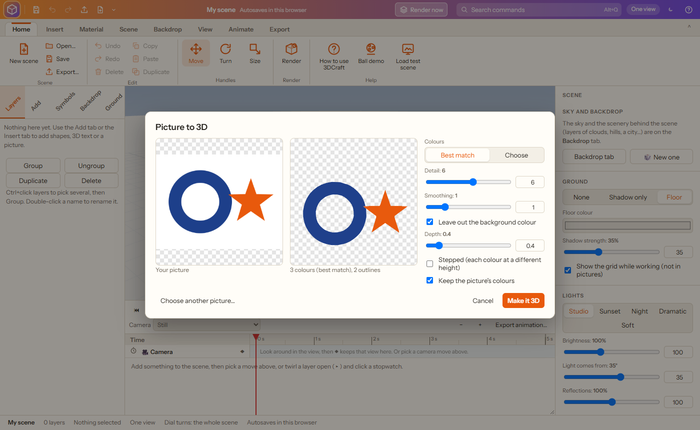
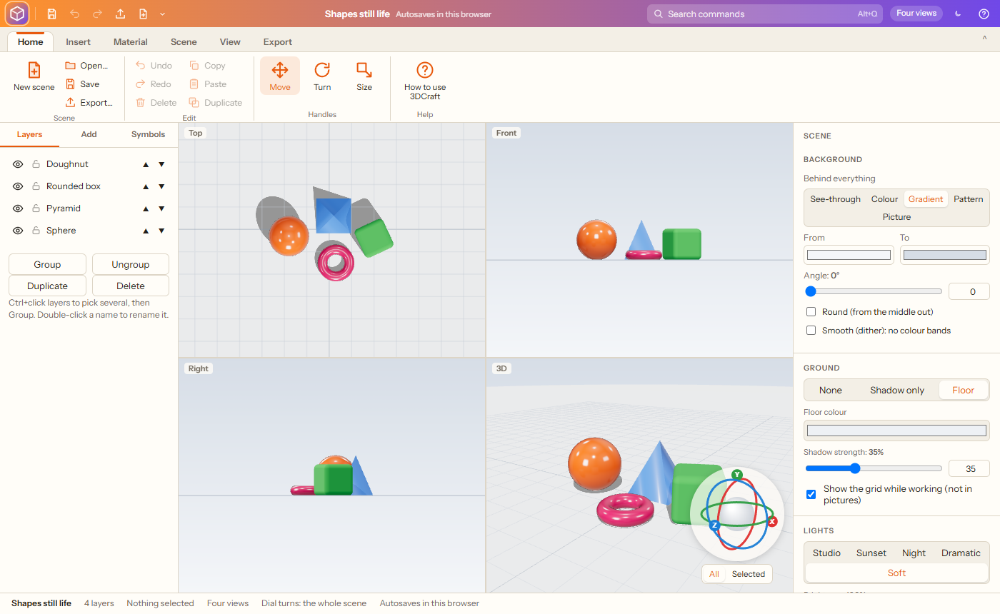
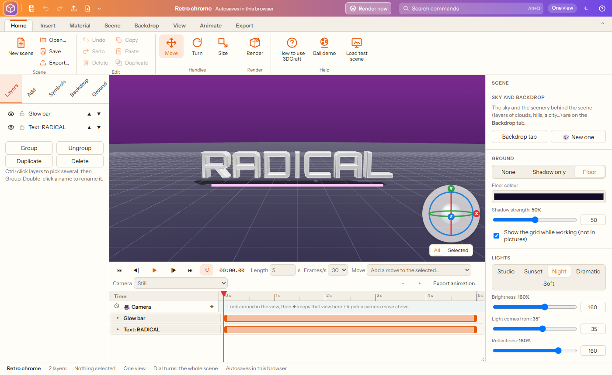
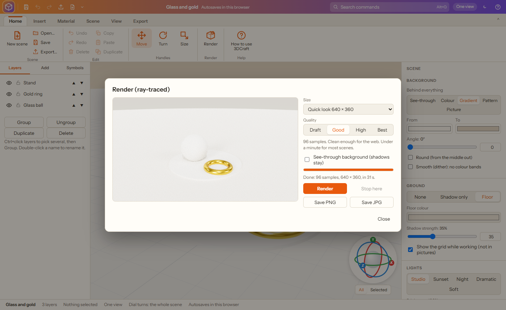
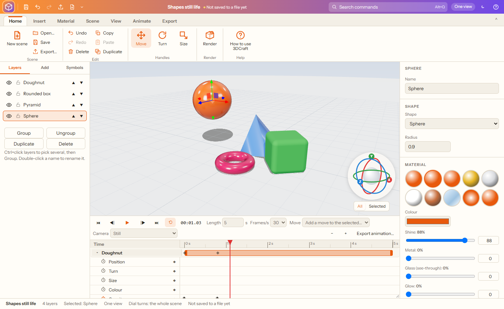

# 3DCraft

**3D titles, logos and scenes in your browser: shapes, 3D text, pictures turned into 3D, materials, lights, animation with a timeline, ray-traced renders, and 3D models in and out.**

3DCraft brings back the easy 3D title and logo programs of the 1990s, rebuilt for today. Type a word and it stands up in 3D gold; drop a logo in and it is traced into colours and pulled out into a solid; pick plastic, chrome or glass; turn it all with the dial in the corner; then render a photo-real picture or save a model for a 3D printer. Everything works offline from this folder.

## Getting started

1. Download this repository (green **Code** button › **Download ZIP**) or clone it.
2. Double-click `index.html`. It opens in Chrome or Edge.
3. Pick a starter scene (3D title, retro chrome, shapes still life, glass and gold, or the **test scene**) or an empty one. **Load test scene** (Home › Help) is a ready-made scene for trying everything: letters spinning in and waving, glass, chrome, gold, copper, glow, plastic, matte and rubber, a gradient on a face, ready-made moves and a camera move; it starts playing straight away.
4. Add things, change them, then **Render** or **Export**.

Your scene autosaves in the browser; **Save** keeps a `.3dcraft.json` file (pictures and models are kept inside it).

## What it does

### Building

- **Shapes:** box, rounded box, sphere, cylinder, cone, pyramid, prism (3 to 24 sides), doughnut, flat ring, capsule, star (any number of points), heart and flat panel, each with its own sizes.
- **Stage** to stand things on: round, oval, square, rectangle, hexagon or octagon; width, depth and height; corners from sharp to round; a rounded rim; 1 to 6 **steps** (a podium) and how far each comes in. Give its top, sides and bottom their own colour, gradient, pattern or picture, and stretch it to distort it.
- **3D text** in 42 fonts (bold and blocky, clean, classic, script, techno and retro), with depth, rounded edges (bevel), letter spacing (letters keep a little apart, and only touch when you turn it below zero), **height** (from short and fat to tall and thin), several lines and alignment.
- **Picture to 3D:** drop a logo or drawing on the view (or Insert › Picture to 3D). It is traced into clean outlines in a few colours (**Best match** finds how many, or choose 2 to 16), with detail and smoothing, and the background left out; each colour is pulled out into 3D, flat or **stepped** (each colour at a different height), in the picture's own colours or a material of your choice.
- **3D symbols and emoji:** the Symbols tab puts dingbats (Noto Sans Symbols 2) and emoji (Noto Emoji) into the scene as solid 3D shapes.
- **3D models in:** GLB, GLTF, OBJ and STL, kept inside the scene file.

### Materials

Plastic, glossy paint, matte, gold, silver, chrome, copper, glass, glow and rubber, then colour, shine, metal, glass (see-through), glow and opacity. Put a **picture, gradient, pattern or colour on every face, or only on the front, back, sides, top or bottom** (shapes and 3D text have their own faces). Gradients and the 33 patterns are the same as in the other Craft apps.

### Moving and turning

- Click something, then drag its **arrows** (move, W), **rings** (turn, E) or **boxes** (size, R), or type exact numbers on the right.
- **Hold the middle mouse button on an object to drag it** (it slides in the plane facing you). Over empty space the middle button slides the view.
- **The dial in the corner** stays put: drag a coloured ring to turn around X, Y or Z, drag the ball to turn freely, click a letter to look along that axis, double-click the ball to reset. It turns **All** (the whole scene) or only the **Selected** object.
- **Layers:** hide, lock, rename, reorder and group; the view: one big view or **four views** (top, front, right, 3D).

### Scene

Background (see-through, colour, gradient, pattern or picture), ground (none, shadow only, or a floor in any colour), lights (studio, sunset, night, dramatic, soft) with brightness and direction, reflections, and the camera lens.

### Render and export

- **Render now** (title bar, next to Search) starts a ray-traced picture of the scene straight away, at the size and quality last chosen.
- **Render (ray-traced)** (F9): light bounces like real light, for true reflections, soft shadows and glass that bends light. Pick a size (from a quick 640 × 360 look to 4K and print sizes) and a quality (**Draft, Good, High, Best**: 24 to 1000 samples). The picture clears up as you watch; stop any time and keep it. **Smooth the grain** (Off, Light, Medium or Strong; Medium to start) cleans up graininess while keeping edges and pictures sharp; change it after rendering to compare, without rendering again. **Edges (anti-aliasing):** normal, or 2×, 3× or 4× smoother (renders that much bigger and shrinks it; slower). See-through background too. Save PNG or JPG.
- **Export:** a quick picture of the view (PNG or JPG, up to 4K or print sizes, see-through if you like), or the 3D model as **GLB** (with colours), **OBJ** or **STL** (for 3D printing), all or only the selected object.

## Keyboard shortcuts

| Keys | What they do |
| --- | --- |
| Ctrl+N / O / S | New / open / save |
| Ctrl+E / F9 | Export / Render |
| Ctrl+Z / Ctrl+Y | Undo / redo |
| Ctrl+C / V / D | Copy / paste / duplicate |
| Delete | Delete |
| W / E / R | Move / turn / size |
| F | See everything |
| 1 / 3 / 7 / 5 | Front / right / top / ¾ view |
| Space / Home / End | Play or pause / start / end |
| , / . | One frame back / on |
| Ctrl+G | Group |
| Esc | Deselect |
| Alt+Q / F10 | Search commands / all menus |

### Animation

The **Timeline** under the 3D view works like a motion-graphics timeline:
- Each layer has a **timer bar**: drag its ends to set when it appears and disappears, or drag the middle to slide it.
- Twirl a layer open (▸) for **Position, Turn, Size, Colour and Opacity**. Click a **stopwatch** to animate one: from then on, moving, turning or sizing the object (with the handles, the dial, middle-mouse dragging or the numbers) makes a **keyframe** ◆ at the current time. ◆ adds or removes a keyframe at the current time.
- **Drag keyframes** to retime them; **double-click** one for how it moves on: linear, ease, ease in, ease out, hold or bounce. Delete removes the selected keyframe.
- **Letter by letter** for 3D text: the letters come in, go out, or keep moving one after another: typewriter, fade, drop in (with a bounce), rise up, grow, spin, flip, slide, scatter (fly together), wave, jump, rock and colour sweep. Choose how long each letter takes, how soon the next one starts, the order (first to last, last to first, middle out, ends in, random) and how far they move. A **Letters** row on the timeline shows when, and can be dragged.
- **Ready-made moves** for the selected object: spin, flip, bounce, fly in, rise up, fade in, fade out, grow in, pulse, float, wobble and colour cycle. The **camera** can stay still, go round on a **turntable** or **swing** to and fro.
- **Camera keyframes:** look around in the view, then click ◆ on the **Camera** row to keep that view at the playhead; the camera swings smoothly from one kept view to the next (with the same eases). Ready-made camera moves: **push in, pull back, crane up, fly round and in**. You can still look around freely while working; the keyed camera takes over when you play or scrub, and clicking a camera keyframe shows that view.
- **Play** (Space), back to the start (Home), to the end (End), one frame back or on (, and .), **loop**, and drag the playhead to scrub. Set the length (up to 2 minutes) and 12 to 60 frames a second.
- **Export the animation** as an animated **GIF** (loops, see-through if you like), **MP4** (H.264), **WebM** (VP9), **AVI** (motion JPEG, the classic way) or a .zip of numbered **PNG frames**, from 480 × 270 up to 4K, square or upright for phones. Frames are drawn one at a time at exact times, so the result is smooth on any computer.

## Requirements

A current Chrome, Edge or Firefox with WebGL 2. Ray-traced renders are much faster with a graphics card.

## How this was made

This app is **vibe coded**: its author designed and directed it in plain conversation, feature by feature, and an AI coding assistant (Claude, by Anthropic) wrote the code.

It is a **genuine clean-room build**, not a decompiled or AI-rebuilt copy of anything:
- Nothing was decompiled, disassembled or reverse-engineered, in whole or in part.
- No code, artwork, fonts, icons or data files from any original program were used, and none were given to the AI to work from.
- 3DCraft is inspired by the 3D title and logo programs of the 1990s (such as Asymetrix Web 3D and 3D F/X), and its timeline by motion-graphics tools; only publicly known features and general ideas guided the design. Every line of code and every starter scene here was made new.

Open-source libraries it uses are listed with their licences in Credits.

## Credits

- [three.js](https://threejs.org) 0.186 (MIT) for 3D, with its add-ons for controls, loaders and exporters.
- [three-gpu-pathtracer](https://github.com/gkjohnson/three-gpu-pathtracer) and [three-mesh-bvh](https://github.com/gkjohnson/three-mesh-bvh) (MIT) for ray-traced renders.
- [opentype.js](https://opentype.js.org) (MIT) for 3D text from fonts.
- [gifenc](https://github.com/mattdesl/gifenc), [webm-muxer](https://github.com/Vanilagy/webm-muxer) and [mp4-muxer](https://github.com/Vanilagy/mp4-muxer) (MIT) for animated GIF, WebM and MP4.
- [ImageTracer](https://github.com/jankovicsandras/imagetracerjs) (public domain) for tracing pictures.
- Fonts from Google Fonts under the SIL Open Font License or the Apache License, stored in `fonts/` (run `python fetch_fonts.py` to download them again).
- Emoji and symbol names from Unicode data (Unicode License).

## Development notes

How 3DCraft is built is described in [NOTES.md](NOTES.md).
